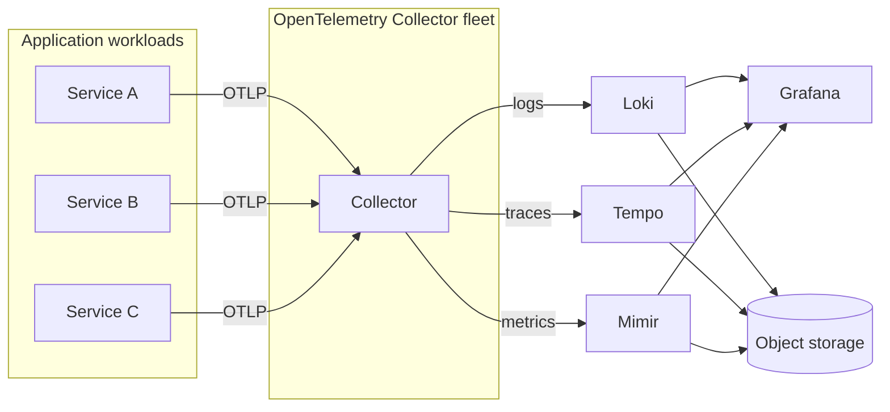

Most teams start observability with metrics. A Prometheus server appears, dashboards get built, and for a while everything feels covered. Then an incident happens and the first question in the channel is *"what does the log say?"* — and nobody can answer it quickly, because logs live in five different places and traces do not exist at all.

The **LGTM stack** — **L**oki, **G**rafana, **T**empo, **M**imir — is Grafana Labs' answer to that problem. It gives you all three pillars of observability in a single, correlated place, and it is significantly cheaper to run than a traditional ELK-plus-APM combination.

This post walks through what each component does, why the combination works, and how to roll it out without boiling the ocean.

## The three pillars, and what breaks when you only have one

| Pillar | Question it answers | Typical tool | Failure mode without it |
| --- | --- | --- | --- |
| **Metrics** | *Is something wrong, and how bad?* | Prometheus / Mimir | You learn about outages from users |
| **Logs** | *What exactly happened?* | Loki / Elasticsearch | You cannot explain the metric spike |
| **Traces** | *Where in the request path?* | Tempo / Jaeger | You know a service is slow, not which hop caused it |

Each pillar alone leaves you guessing. Metrics tell you that p99 latency tripled. Logs tell you that the payments service started throwing timeouts. Traces tell you the timeout originates from a downstream database call in one specific replica. Only correlation gets you from symptom to root cause in minutes.

## What each piece of LGTM actually does

### Loki — logs

Loki is often described as "Prometheus, but for logs." The key design decision is that **Loki indexes only labels, not the full text of every log line**. Log content is compressed and stored in object storage (S3, GCS, Azure Blob) as chunks.

That means:

- Ingestion and storage costs are a fraction of a full-text-indexed system.
- Queries are fast when you start from labels (`{namespace="payments", app="api"}`) and then filter with `|=` and `|~`.
- You cannot do arbitrary full-text search across your entire log history without knowing the labels — this is a deliberate trade-off.

The practical rule: **keep labels low-cardinality**. `namespace`, `app`, `container`, `level` are good labels. `request_id`, `user_id`, or a raw URL are not — they will explode your index and defeat the point of Loki.

### Mimir — metrics at scale

Prometheus is excellent, but a single Prometheus instance has a ceiling. Long-term retention, high availability, and multi-tenancy all become painful.

Mimir is horizontally scalable, Prometheus-compatible long-term storage. It accepts remote writes from Prometheus or the OpenTelemetry Collector, uses object storage for blocks, and can query across all of them with PromQL. If you are running more than one Prometheus or need more than a few weeks of retention, Mimir is the natural next step.

### Tempo — traces

Tempo stores distributed traces in object storage, indexed by `trace_id`. It uses the same Grafana-native approach as Loki: cheap storage, no heavy index.

It accepts traces over **OTLP** (OpenTelemetry Protocol), which is what makes it a natural fit if you are already using the OpenTelemetry Collector. Its real power is not being a trace UI on its own — it's that Grafana can jump from a metric exemplar or a log line straight to the relevant trace, and back.

### Grafana — the correlation layer

Grafana is not "just a dashboard tool" here; it is the thing that makes the other three useful together. The whole point of LGTM is **correlation**, and it happens through:

- **Exemplars** — a metric datapoint carries a `trace_id`, so clicking a latency spike opens the exact trace.
- **Derived fields** — a log line contains a `trace_id`, so Loki turns it into a clickable link to Tempo.
- **Trace to logs** — a span has a timestamp and resource attributes, so Tempo links back to the log lines emitted during that span.
- **Trace to metrics** — a span can link to the service's RED dashboard.

Once that wiring exists, incident response changes character. You stop guessing which system to check and start following links.

## What you need before you start

- A **Kubernetes cluster** (local k3s is fine — see my [k3s post](/blog/kubernetes-local-k3s/)).
- **Helm 3**.
- **Object storage** for anything beyond a test. For local experiments, MinIO or even filesystem storage works, but plan for S3-compatible storage in production — it is what makes Loki, Tempo, and Mimir economical.
- An **OpenTelemetry Collector** as the ingestion point. This is the piece that keeps you vendor-agnostic.

## Architecture



Everything the applications emit goes to the collector, and the collector decides where each signal goes. Applications never talk to Loki, Tempo, or Mimir directly — which means you can change backends without touching a single service.

## Rolling it out in stages

Do not deploy all four at once. That is the fastest way to end up with three broken systems and no idea which one is misconfigured. Each stage below is independently useful, and you stop whenever your needs are met.

### Stage 1 — Metrics first (Mimir or plain Prometheus)

Start with the pillar you already understand. If you are small, run Prometheus; the OpenTelemetry Collector's Prometheus receiver or remote-write exporter handles the integration either way.

```yaml
# otel-collector-config.yaml (metrics pipeline)
receivers:
  otlp:
    protocols:
      grpc:
        endpoint: 0.0.0.0:4317
      http:
        endpoint: 0.0.0.0:4318

exporters:
  prometheusremotewrite:
    endpoint: "http://mimir-nginx.mimir.svc:80/api/v1/push"
    resource_to_telemetry_conversion:
      enabled: true

service:
  pipelines:
    metrics:
      receivers: [otlp]
      exporters: [prometheusremotewrite]
```

**Success criterion:** you can answer "what is our request rate and error ratio per service?" from one dashboard.

### Stage 2 — Logs into Loki

Ship logs through the collector's `filelog` receiver rather than running a per-node agent just for logs. This keeps one agent, one config, one upgrade path.

```yaml
receivers:
  filelog:
    include: [/var/log/pods/*/*/*.log]
    include_file_path: true
    operators:
      - type: container
        id: container-parser
        # extracts k8s metadata from the pod log path

processors:
  k8sattributes:
    extract:
      metadata: [k8s.namespace.name, k8s.pod.name, k8s.container.name]
  resource:
    attributes:
      - key: cluster
        value: "prod-eu"
        action: upsert

exporters:
  loki:
    endpoint: "http://loki-gateway.loki.svc:80/loki/api/v1/push"
    labels:
      resource:
        k8s.namespace.name: "namespace"
        k8s.container.name: "container"

service:
  pipelines:
    logs:
      receivers: [filelog]
      processors: [k8sattributes, resource]
      exporters: [loki]
```

That explicit `labels` block is the most important part of the whole config. It is where you enforce low cardinality — only these resource attributes become Loki index labels, everything else stays in the log body where it is free.

**Success criterion:** given a namespace and an app name, you can find the error logs within seconds.

### Stage 3 — Traces into Tempo

Instrument your applications with the OpenTelemetry SDK, or use auto-instrumentation to avoid touching code at all.

```yaml
processors:
  batch:
    timeout: 5s
    send_batch_size: 1024

exporters:
  otlp/tempo:
    endpoint: "tempo-distributor.tempo.svc:4317"
    tls:
      insecure: true

  # tail-sampling: keep all errors/slow traces, sample the rest
  tail_sampling:
    decision_wait: 10s
    policies:
      - name: errors
        type: status_code
        status_code: { status_codes: [ERROR] }
      - name: slow-requests
        type: latency
        latency: { threshold_ms: 500 }
      - name: baseline
        type: probabilistic
        probabilistic: { sampling_percentage: 5 }

service:
  pipelines:
    traces:
      receivers: [otlp]
      processors: [tail_sampling, batch]
      exporters: [otlp/tempo]
```

The tail-sampling policy above is worth copying as a starting point. It keeps **100% of errors and slow requests** while sampling only 5% of healthy traffic — which means you can investigate every incident without paying to store the boring requests.

**Success criterion:** you can open a slow request and see which service and which database call consumed the time.

### Stage 4 — Wire up correlation

Only now, once all three signals exist, add the links between them:

- In Loki's datasource config, add a derived field for `trace_id` that links to the Tempo datasource.
- In Tempo's datasource config, enable **traces to logs** with the `k8s.namespace.name` and `k8s.pod.name` tag mapping so a span links to its logs.
- In Mimir's datasource config, enable **exemplars** so metric spikes link to traces.

**Success criterion:** from a spike on a latency graph, you reach the offending trace and its logs in two clicks.

## How this pairs with OpAMP

Running an OpenTelemetry Collector per node means a fleet of collectors, and a fleet needs management. That is exactly the problem **OpAMP (Open Agent Management Protocol)** solves — a control plane where collectors register, receive their configuration remotely, and report health.

Without it, every collector config change is a config-management rollout and every misconfigured agent fails silently. With it, onboarding a new node to full observability becomes automatic: the collector registers and receives the pipeline configuration above without anyone logging into the host.

That is the direction I am taking this in production, and I wrote about the fleet-management problem in more detail in my [experience section](/experience).

## Pitfalls worth knowing before you deploy

**Label cardinality will hurt you.** The single most common Loki mistake is putting `trace_id` or `request_id` into a label. It works fine in staging with ten requests per second and destroys the index in production. When in doubt, leave it out of labels and filter it in the query.

**Tail sampling needs a load-balanced collector tier.** To sample by trace you must see all spans of a trace in the same collector, which means routing by `trace_id` across a collector tier and running the sampler there. A single-collector setup with `tail_sampling` in it will sample incorrectly under load.

**Object storage is not optional at scale.** Filesystem storage for Loki, Tempo, or Mimir works for a demo and fails the moment you run more than one replica or need retention. Design for S3-compatible storage from the start, even if you point it at MinIO locally.

**Metric retention is a cost decision, not a technical one.** Mimir will happily store everything forever. Decide your retention windows per tenant deliberately, because the bill grows silently.

**Schema versions matter for Loki.** Loki's storage schema is versioned and you cannot change it retroactively. Getting the `schema_config` periods right on day one saves a painful migration later.

## Closing thoughts

The LGTM stack is not valuable because of any single component — each one is replaceable. It is valuable because **all three signals land in Grafana and are linked to each other**. Metrics tell you something is wrong, traces tell you where, and logs tell you why. When those transitions are a click instead of a separate investigation, mean time to resolution drops more than any individual tool upgrade would achieve.

Start with metrics, add logs, then traces, and wire the correlation last. Resist the urge to deploy the whole stack on day one.
